# PreOrderFlow — Carte d'architecture (Mermaid)

Diagrammes Mermaid exploitables de l'application v0.35.1.
Rendus nativement par GitHub, GitLab et la plupart des éditeurs Markdown.

---

## 1. Vue d'ensemble — monorepo

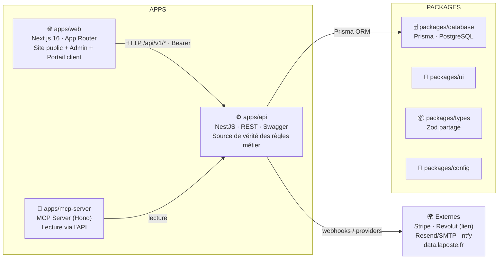

---

## 2. Modules backend (apps/api) et leurs dépendances

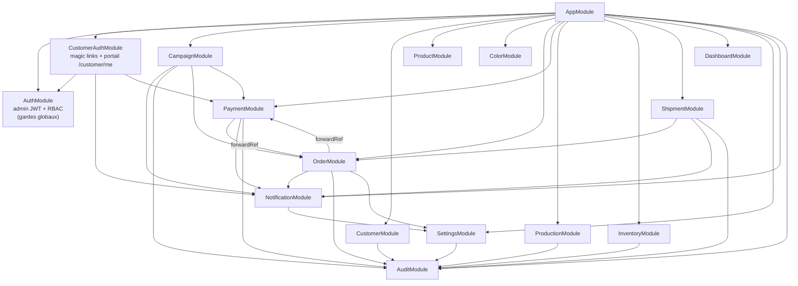

---

## 3. Modèle de données (Prisma — PostgreSQL)

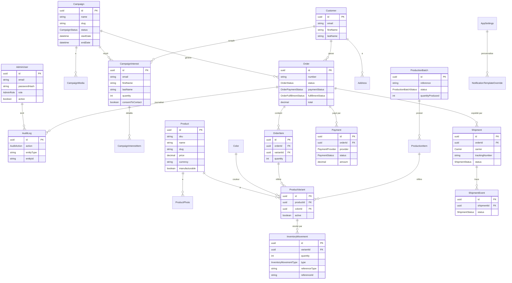

---

## 4. Workflow métier fondamental (jamais fusionné)

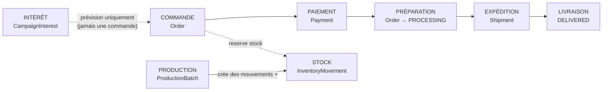

---

## 5. Machines à états

### Statut de commande

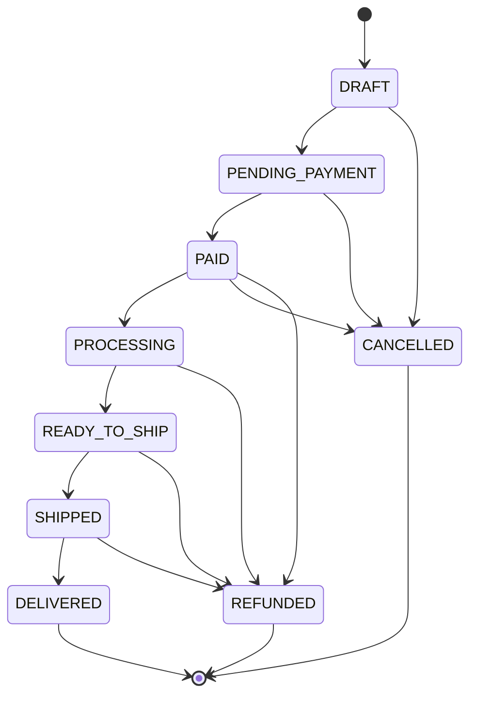

### Statut de campagne

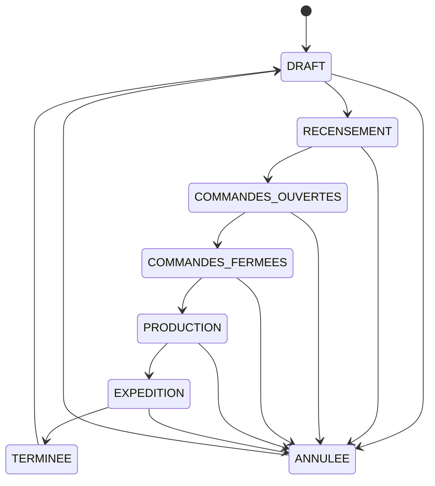

### Statut de production

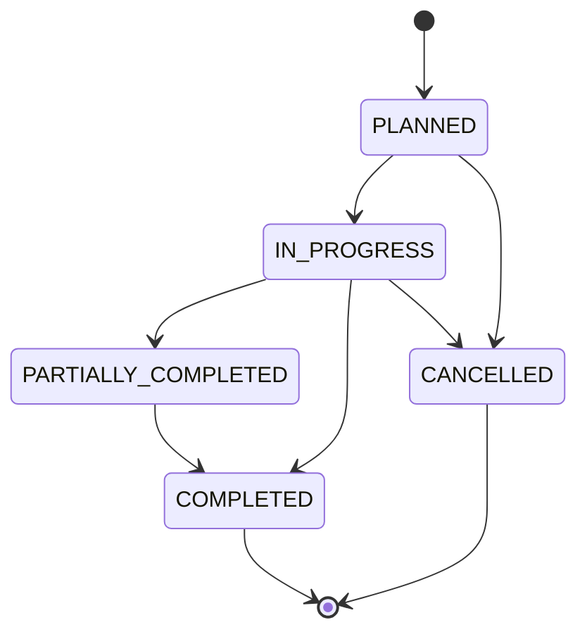

### Statut d'expédition

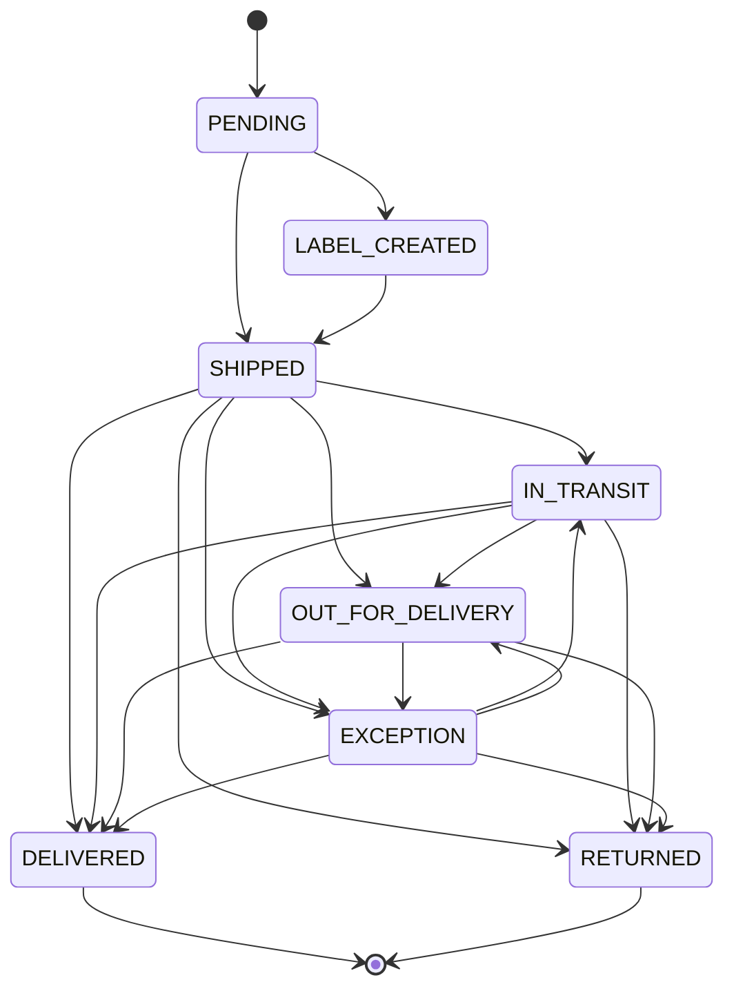

---

## 6. Calcul du stock (toujours dérivé, jamais stocké)

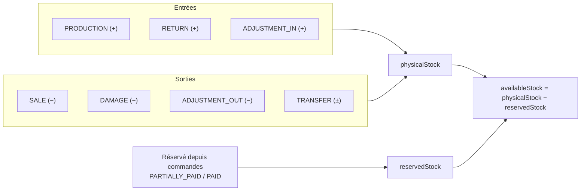

---

## 7. Vue applicative — requêtes frontend → backend

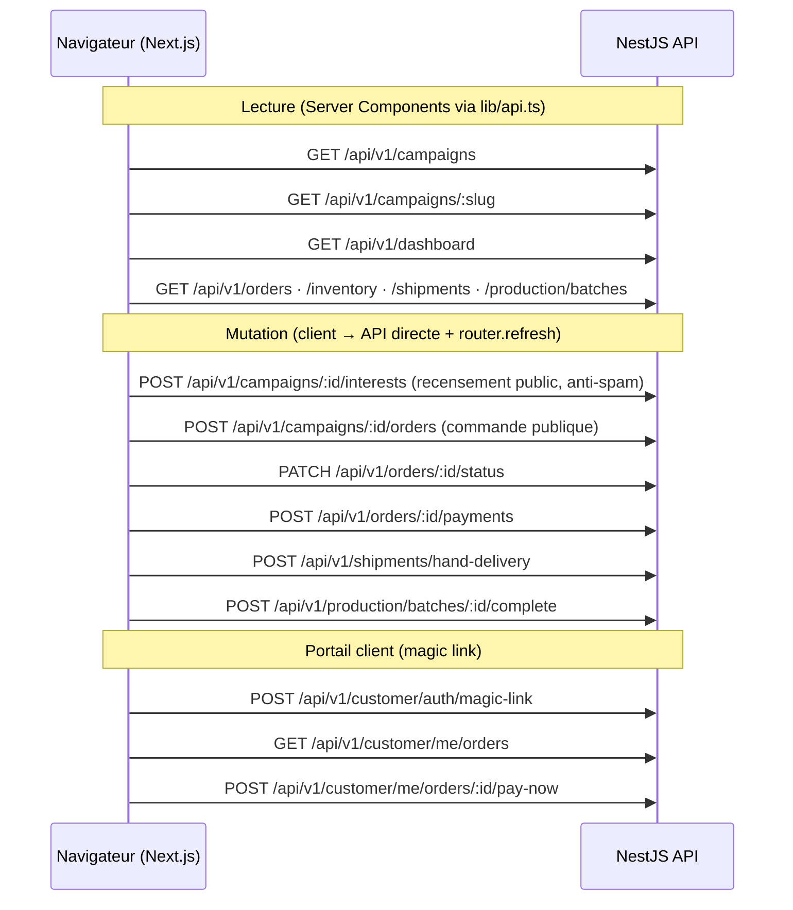

---

## 8. Intégrations externes

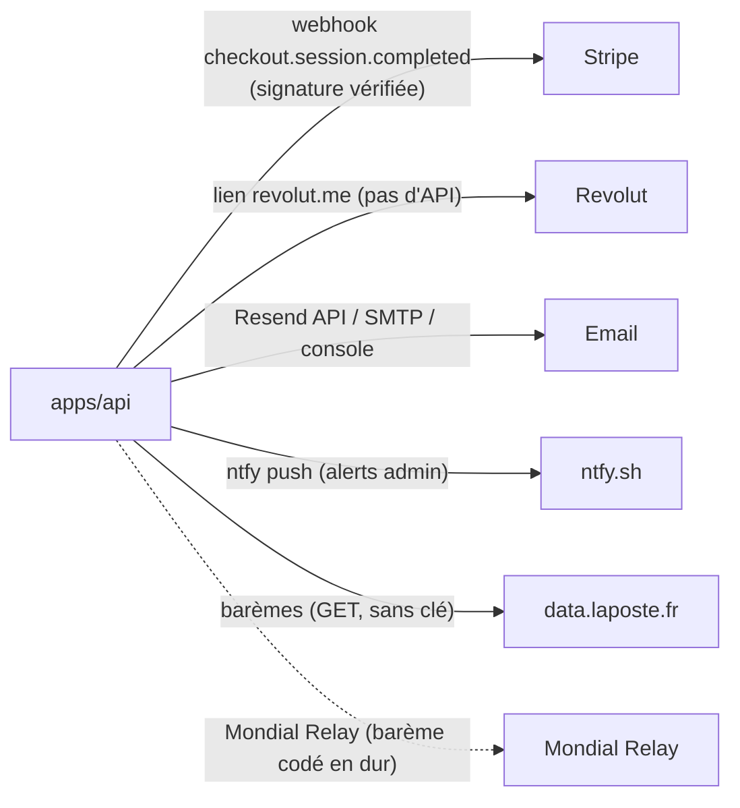
